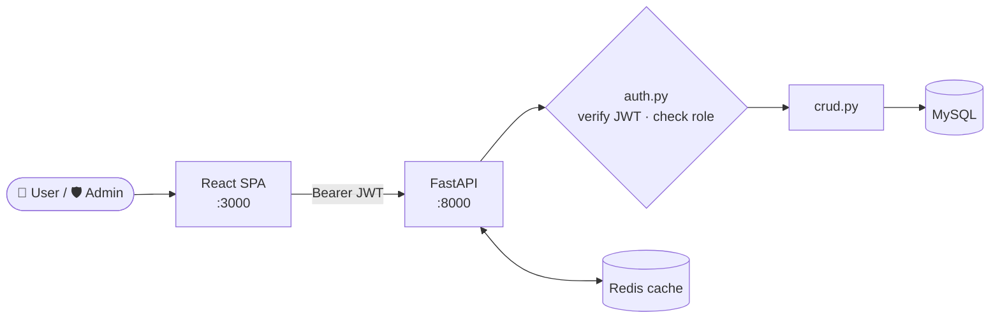
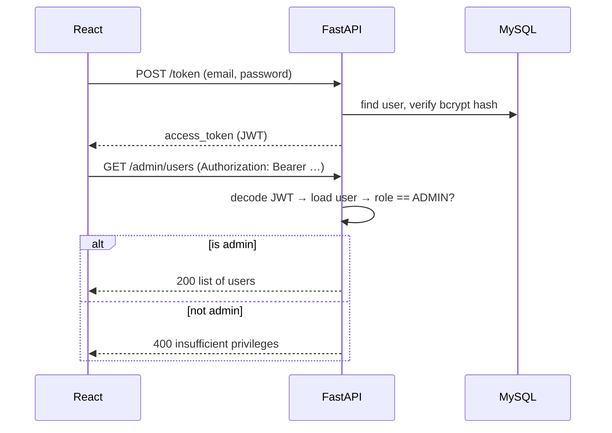

<div align="center">

# 🛡️ FastAPI × React — Control Panel

**A full-stack user-management ERP with JWT authentication and role-based access control (RBAC): users manage their own profile, admins manage everyone.**


[Features](#-features) · [Architecture](#%EF%B8%8F-architecture) · [Setup](#-getting-started) · [API](#-api-reference) · [Structure](#-project-structure)

</div>

---

## ✨ Features

| Role | Can do |
|---|---|
| 👤 **User** | Register · log in · view and update own profile · personal dashboard |
| 🛡️ **Admin** | Everything a user can, plus list all users · add users · edit any user (incl. role) · delete users |

- 🔐 **OAuth2 password flow + JWT** (python-jose) with bcrypt-hashed passwords (passlib)
- 🧭 **Role-based route guards** on both the API (`get_current_admin` dependency) and the UI (`PrivateRoute`)
- ⚡ **Redis cache layer** wired in at startup via `fastapi-redis-cache` (ready for `@cache` on any endpoint)
- 🗄️ **MySQL + SQLAlchemy ORM**, tables auto-created on startup
- 📘 **Interactive API docs** at `/docs`
- 🎨 React dashboard with sidebar, top bar, user table and toast notifications

## 🏗️ Architecture



<details>
<summary><b>🔐 Login & authorisation flow</b></summary>

<br/>



</details>

## 🚀 Getting Started

### Prerequisites

- Python 3.10+
- Node.js 18+
- A running **MySQL** server and **Redis** server

### 1. Clone

```bash
git clone https://github.com/Shariq2003/FastAPI_Control_Panel.git
cd FastAPI_Control_Panel
```

<details open>
<summary><b>2. Backend (repo root)</b></summary>

```bash
python -m venv venv
source venv/bin/activate          # Windows: venv\Scripts\activate
pip install -r requirements.txt
pip install fastapi-redis-cache   # used by app/main.py for caching

cp .env.example .env              # fill in MySQL, JWT and Redis values
uvicorn app.main:app --reload     # http://localhost:8000  ·  docs at /docs
```

To allow a different frontend URL, edit the `origins` list in `app/main.py`.

</details>

<details open>
<summary><b>3. Frontend (<code>fastapi-react-frontend/</code>)</b></summary>

```bash
cd fastapi-react-frontend
npm install
cp .env.example .env              # REACT_APP_SERVER_API_URL=http://localhost:8000
npm run devStart                  # http://localhost:3000
```

</details>

<details>
<summary><b>⚙️ Environment variables</b></summary>

**Backend `.env`**

| Variable | Description |
|---|---|
| `MYSQL_USER` / `MYSQL_PASSWORD` | Database credentials |
| `MYSQL_HOST` / `MYSQL_PORT` / `MYSQL_DB` | Database location & name |
| `JWT_SECRET_KEY` | Secret used to sign tokens |
| `REDIS_HOST` / `REDIS_PORT` / `REDIS_DB` / `REDIS_PASSWORD` | Redis connection |

**Frontend `.env`**

| Variable | Description |
|---|---|
| `REACT_APP_SERVER_API_URL` | Base URL of the FastAPI server |

</details>

> 💡 **Roles:** the registration form lets you pick `USER` or `ADMIN`, and admins can create users of either role from the dashboard.

## 📡 API Reference

| Method | Endpoint | Access | Description |
|---|---|---|---|
| `POST` | `/token` | Public | Log in (OAuth2 form) → JWT |
| `POST` | `/register` | Public | Create an account |
| `GET` | `/users/me` | User | Current user's profile |
| `PUT` | `/users/me` | User | Update own profile |
| `GET` | `/admin/users` | Admin | List all users |
| `PUT` | `/admin/users/{user_id}` | Admin | Update any user |
| `DELETE` | `/admin/users/{user_id}` | Admin | Delete a user |

## 📁 Project Structure

<details>
<summary><b>Expand tree</b></summary>

```text
FastAPI_Control_Panel/
├── app/
│   ├── main.py                # FastAPI app, CORS, Redis cache, router
│   ├── routes/routes.py       # all endpoints
│   ├── auth.py                # JWT creation/validation, current user/admin
│   ├── crud.py                # DB operations
│   ├── models.py              # SQLAlchemy User model
│   ├── schemas.py             # Pydantic schemas
│   ├── database.py · config.py · dependencies.py
├── requirements.txt
├── .env.example
└── fastapi-react-frontend/
    └── src/
        ├── components/        # LoginForm, RegistrationForm, UserTable, AdminDashboard,
        │                      # UserDashboard, AddNewUser, UserProfile, SideBar, TopBar, PrivateRoute
        ├── pages/             # Home, Login, Dashboard
        ├── context/AuthContext.js
        └── services/          # axios client, auth & principal helpers
```

</details>

---

<div align="center">

Built by **[Shariq](https://github.com/Shariq2003)** · [LinkedIn](https://www.linkedin.com/in/shariq-sd)

⭐ If you like this project, consider giving it a star!

</div>
